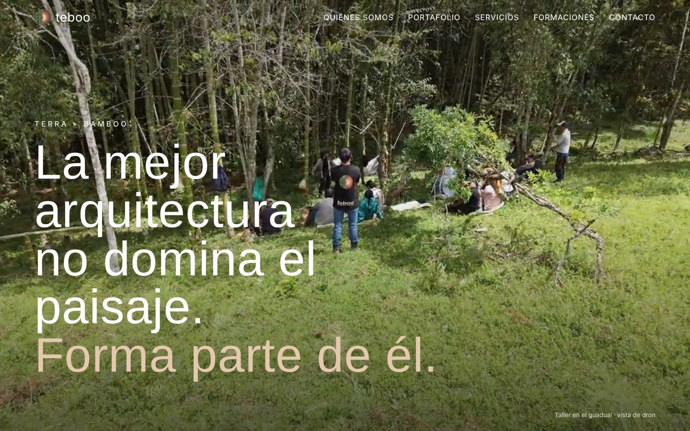
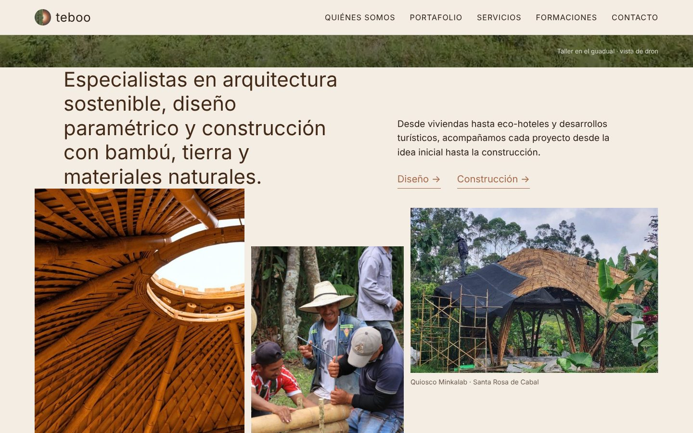
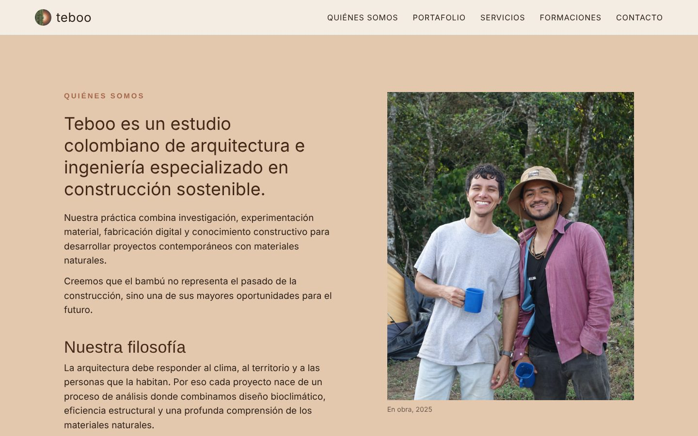
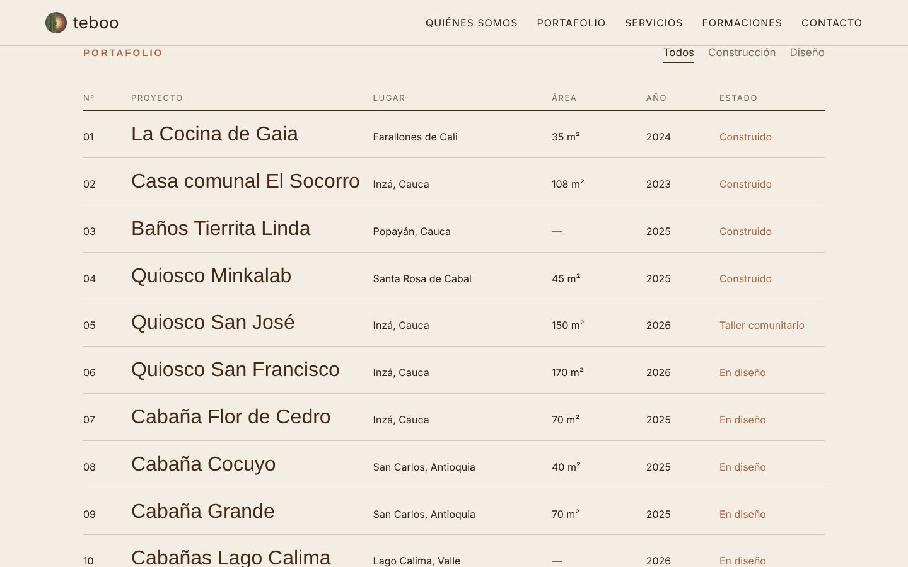
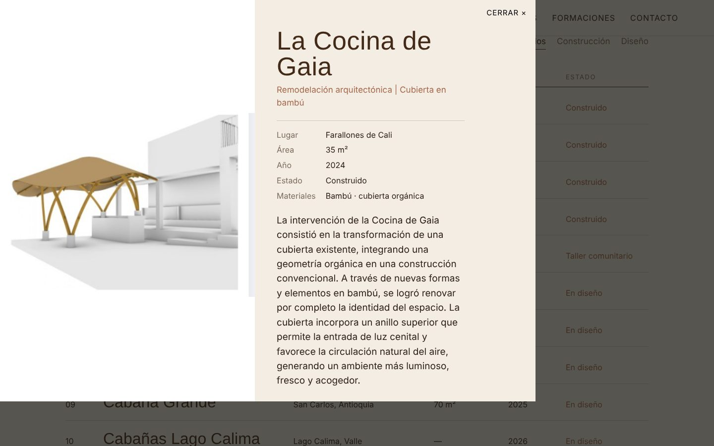
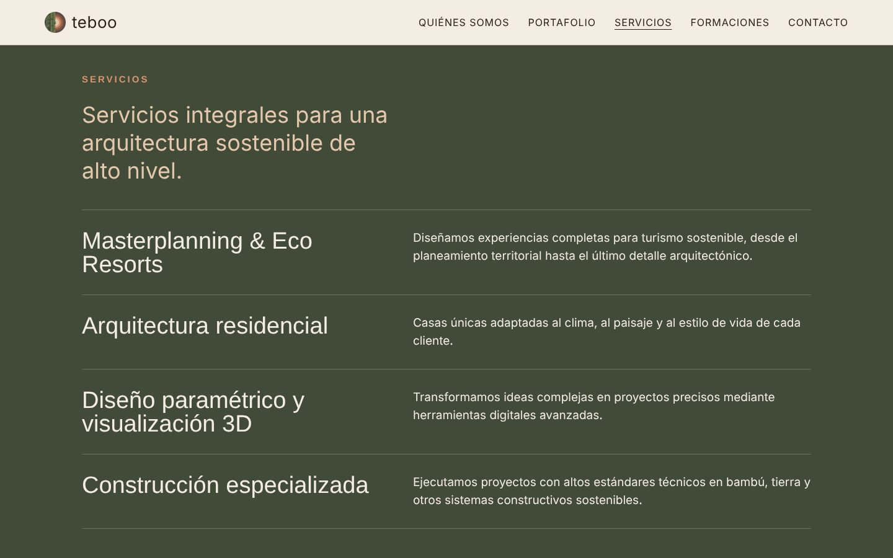
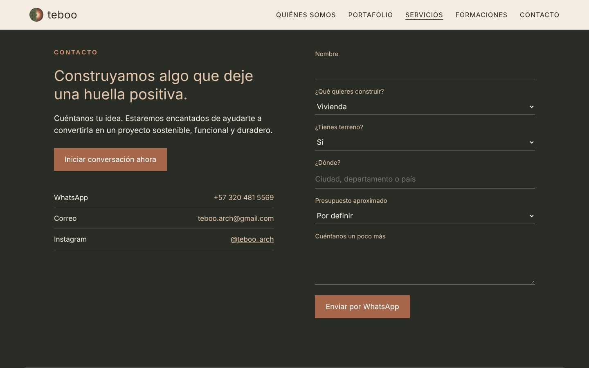
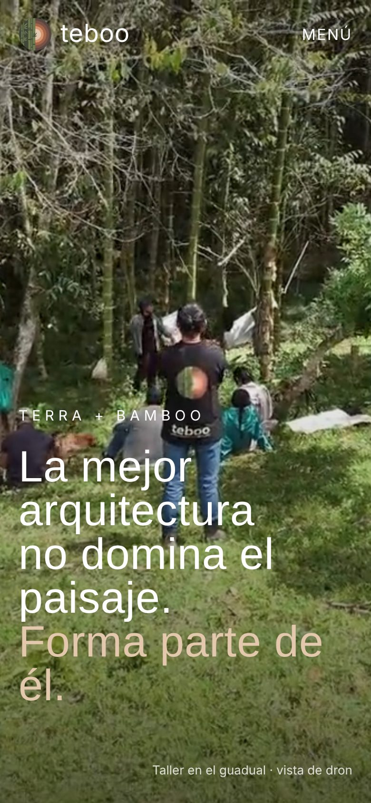

# Teboo — Sitio web

Sitio web de **Teboo (Terra + Bamboo)**, estudio colombiano de arquitectura e ingeniería especializado en construcción sostenible con bambú, tierra y materiales naturales.

Es la versión web del portafolio 2026. La estructura y los textos salen del tablero de Miro del equipo (sección *Sitio web ideas*) y de la propuesta *Estructura estratégica del sitio web*.



## Secciones

| Sección | Contenido |
|---|---|
| **Inicio** | Video de dron en bucle, frase principal, presentación corta y fotos de obra |
| **Cómo trabajamos** | Los cuatro principios: materiales vivos, precisión digital, impacto positivo, aprender construyendo |
| **Quiénes somos** | Presentación, filosofía, equipo y “Del boceto a la obra” (bocetos de inspiración) |
| **Portafolio** | Índice de proyectos con filtro Construcción / Diseño, ficha técnica de cada proyecto y galería de obra |
| **Servicios** | Masterplanning & eco resorts, arquitectura residencial, diseño paramétrico y 3D, construcción especializada |
| **Formaciones** | Talleres de bioconstrucción, taller de maquetas y diario de obra |
| **Contacto** | Botón directo a WhatsApp y formulario (tipo de obra, terreno, lugar, presupuesto) que prepara el mensaje |















## Cómo está hecho

Sitio estático, sin frameworks ni dependencias: se puede abrir directamente en el navegador.

```
index.html     página en español (generada)
en/index.html  página en inglés (generada)
data.py        proyectos y galería, en español e inglés  ← aquí se editan los textos de proyectos
build.py       textos de la página en ES/EN y generación de los dos HTML
style.css      estilos (paleta del logo, Bebas Neue y Abel, contrastes AA)
main.js        menú, video, filtros, fichas, galería arrastrable y formulario → WhatsApp
img/           fotos (img/p = proyectos), videos de portada (escritorio y móvil), logo, imagen para compartir
docs/          capturas de este README
```

Después de cambiar textos o fotos: `python3 build.py`.

Para verlo en local:

```bash
python3 -m http.server 8000
# abrir http://localhost:8000
```

## Publicación

El sitio se publica con **Vercel** conectado a este repositorio: cada cambio en la rama `main` se publica solo en un minuto. No hay comando de compilación (proyecto “Other”, directorio raíz).

## Pendiente

- Fotos JPG de cada proyecto (las del Drive están en RAW .CR3)
- Más videos de dron cortos (menos de 10 MB) para montar los mejores momentos en la portada
- Textos de presentación de Santiago y José
- Revisar la traducción al inglés
- Texto definitivo de *Cabañas Lago Calima* y área de Baños Tierrita Linda
- Cifras reales (m² construidos, personas formadas) si el equipo quiere mostrarlas
- Tienda (libro, camisas) y enlaces a las demás redes sociales
- Poner el dominio definitivo en `SITE` (build.py) para que la vista previa al compartir funcione en todas las apps
- Dominio propio y hosting definitivo si se aprueba el sitio
